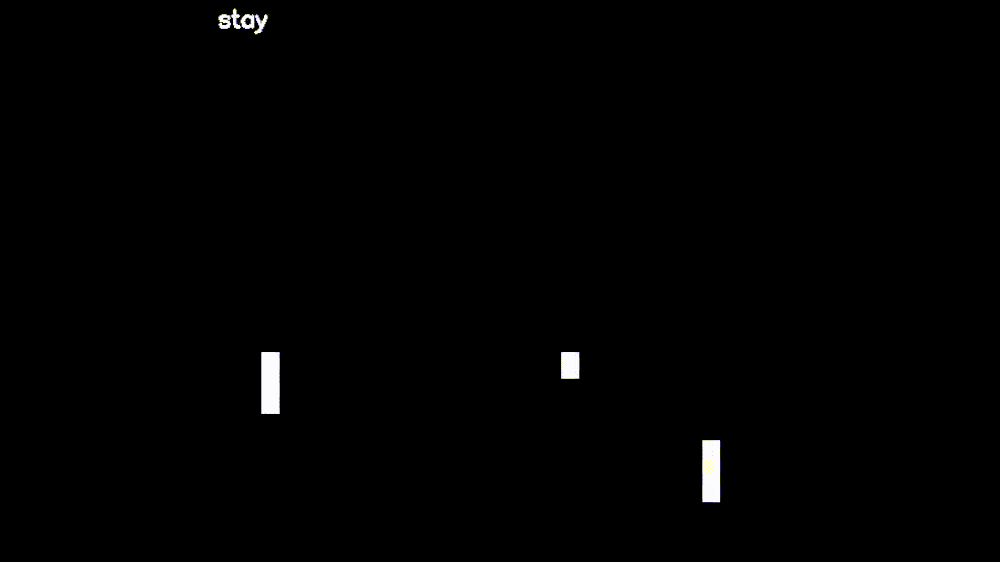

# Pong World Model

A small world model that learned to play Pong by watching it. There's no game engine, every frame is dreamed up by a neural network, one step at a time, based on the keys you press.



The idea comes from DeepMind's [Genie](https://arxiv.org/abs/2402.15391) paper, scaled down so it trains on a regular gaming GPU.

## How it works

The model has two parts, trained one after the other.

**1. Tokenizer (`model/video_tokenizer.py`)**
A convolutional autoencoder. It squeezes a 64x64 frame into a vector of 128 numbers and can turn that vector back into an image. Everything else works in this compressed space, which is much cheaper than working with pixels.

Pong frames are mostly empty, so with a plain MSE loss the tokenizer ignores the ball. To fix that, the frames are made black and white, and errors on white pixels (ball and paddles) count 20x more in the loss.

**2. Dynamics model (`model/dynamic_model.py`)**
A small causal transformer (4 layers, ~3M parameters). It looks at the last 8 latents plus the action taken at each step (stay, up, down) and predicts the next latent. It predicts the *change* from the current frame rather than the full frame, which is easier to learn.

**Playing (`main.py`)**
The game starts from 8 real frames. After that it runs in a loop:

1. Read the key you're holding (W = up, S = down, nothing = stay).
2. The dynamics model predicts the next latent.
3. The tokenizer decodes it into an image, which is what you see.
4. That image gets encoded again and added to the context, and the oldest frame drops out.

Step 4 matters. Without it, small prediction errors pile up and after a few seconds the screen turns into static. Re-encoding pulls each guess back onto latents the model has actually seen. During training, the dynamics model also gets slightly noisy inputs and a second pass on its own predictions, so it learns to recover from its mistakes.

## Differences from Genie

Genie learns the actions on its own with a *latent action model*, since it trains on internet videos that have no controller inputs. I tried that too (`model/latent_action_model.py`), but on Pong the learned codes didn't map cleanly to "up" and "down". Since we can record the real actions anyway, the final version just uses those. Genie also uses discrete tokens (VQ-VAE) and a much larger spatiotemporal transformer, while this project uses one continuous vector per frame.

## Running it

```bash
pip install -r requirements.txt

cd data && python data_gen.py && cd ..
python train_models/train_tokenizer.py
python train_models/train_dynamic_model.py
python main.py
```

Training curves and sample predictions are saved in `stats/`. Holding keys uses the Windows API, so `main.py` runs on Windows only.

## Reference

Bruce, J., Dennis, M., Edwards, A., et al. *Genie: Generative Interactive Environments.* ICML 2024. [arXiv:2402.15391](https://arxiv.org/abs/2402.15391)

```bibtex
@inproceedings{bruce2024genie,
  title     = {Genie: Generative Interactive Environments},
  author    = {Bruce, Jake and Dennis, Michael and Edwards, Ashley and others},
  booktitle = {International Conference on Machine Learning},
  year      = {2024}
}
```
